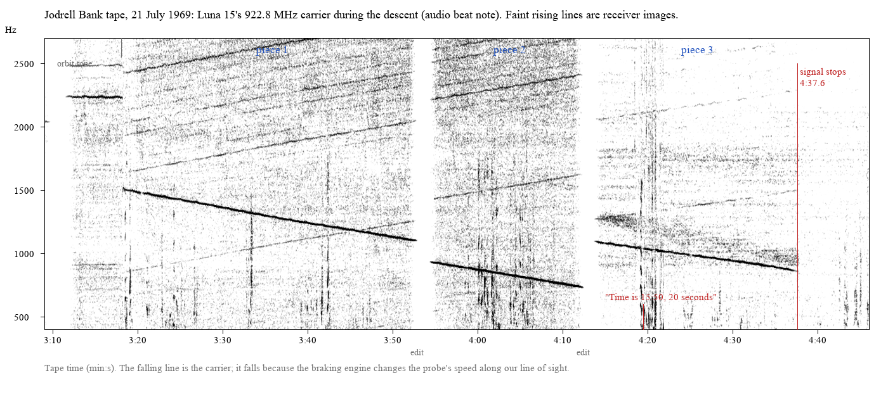

# Luna 15 (1969): its last minutes on the Jodrell Bank tape

Write-up: **https://luna15.n4ze3m.com/**

On 21 July 1969 the Soviet probe Luna 15 tried to land in Mare Crisium and crashed while Apollo 11 was on the Moon.
Jodrell Bank followed it and in 2009 released an edited control-room recording. This repo measures the probe's
922.8 MHz carrier on that recording.



## Results (from `data/summary.json`)
- **Braking:** through the three pieces of the descent the carrier falls 9.0-12.5 Hz/s, i.e. 2.9-4.0 m/s² along the
  line of sight. Gravity alone would give 0.64 m/s².
- **End of signal:** the carrier stops at tape 4:37.594 while still falling at 12.1 Hz/s, so the engine was still firing.
  The 98 Hz hum is continuous through that instant, so it is not an edit.
- **Timing:** a voice reads "Time is 15:50, 20 seconds" 17.0-19.2 s of tape earlier, giving about 15:50:37-39 UT for the
  end. The Soviet record gives 15:50:40.
- **A one-sided band:** in the last piece only, there is 40-300 Hz of extra power above the carrier and none below it.
  From 4:20.5 it averages +5.6 dB over 16 one-second windows. Pieces 1-2 average -0.5 dB, and a carrier-free control
  gives -1.0 dB. Its centre moves from about +176 to +85 Hz. It is most likely the signal reflected from the lunar
  surface, but that is an interpretation; see the write-up.

## What was already known
- Jodrell Bank watched the Doppler shift live in 1969 and reported the burn and the loss of signal at the time.
- The Soviet record (engine on 15:46:43 UT, contact lost 15:50:40 in the 237th second) comes from later sources.
- That the falling pitch is Doppler had been explained before.
- This repo only adds measurements of the released tape.

## Run it
The audio is not included. Download `Luna15-Apollo11.mp3` from Jodrell Bank:
https://www.jb.man.ac.uk/multimedia/audio/luna15-apollo11.html

You need Python 3 with numpy, scipy and pillow, and ffmpeg on PATH. `luna15.py` writes `carrier.csv`, `band.csv` and
`summary.json` into the output folder.

```
pip install numpy scipy pillow
python luna15.py Luna15-Apollo11.mp3 out/
python make_figures.py Luna15-Apollo11.mp3 img/
```

## Files
- `luna15.py`: carrier tracking and fits, loss of signal, receiver image lines, the band test with controls, in-orbit
  drifts, geometry.
- `make_figures.py`: the figures in `img/`.
- `data/`: the outputs of one run. Column descriptions are in `data/README.txt`.

## Credits and licence
- **Audio:** (c) Jodrell Bank Centre for Astrophysics, University of Manchester. The audio is not redistributed here.
- **Data:** the files in `data/` are measurements taken from that recording; please credit Jodrell Bank when using them.
- **Background:**
  - Sven Grahn, *Jodrell Bank's role in early space tracking activities* (Jodrell's 1969 statements, 922.8 MHz).
  - Russian Wikipedia, *Луна-15* (the Soviet timeline).
  - D. Estévez, *Lunar reflections during SLIM landing* (2024).
  - H. T. Howard and G. L. Tyler, *Dual-frequency bistatic-radar investigations of the Moon with Apollos 14 and 15* (1973).
- **Geometry:** JPL Horizons.
- **Code:** MIT licence (see `LICENSE`).
